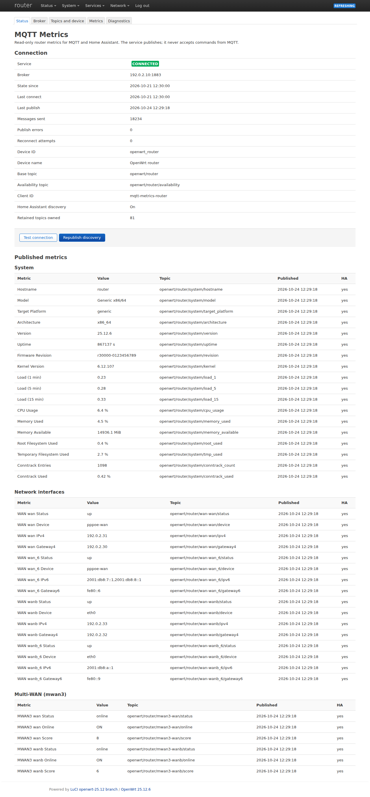
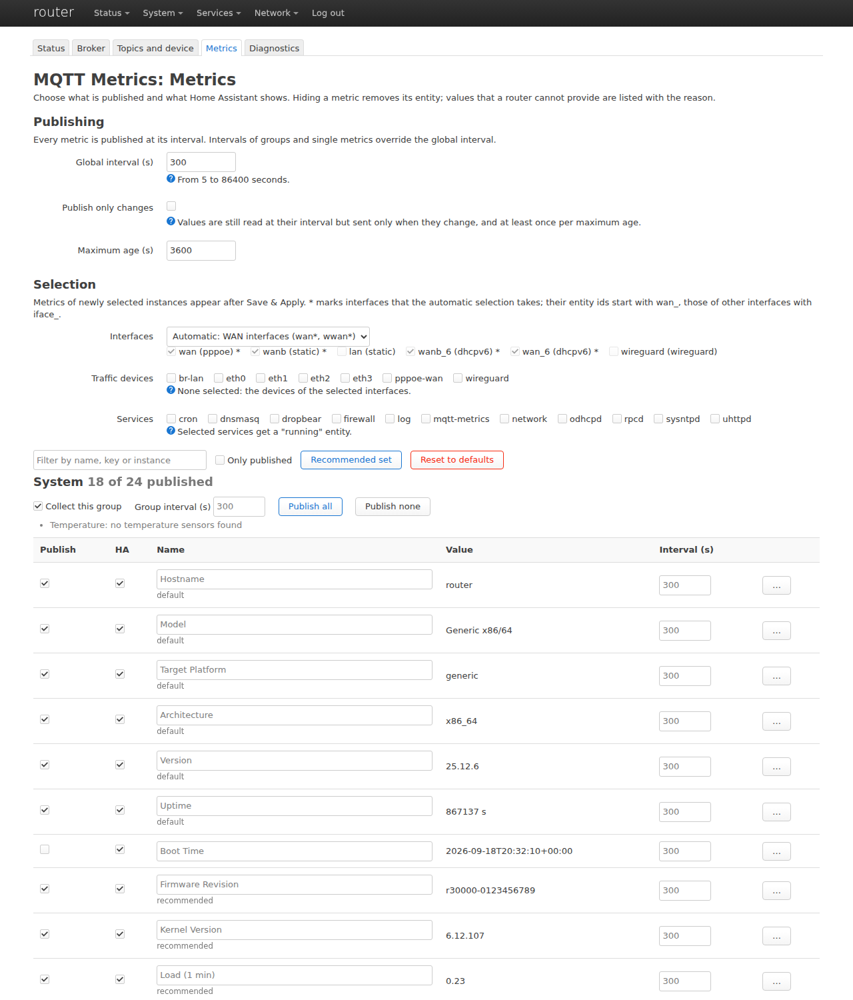
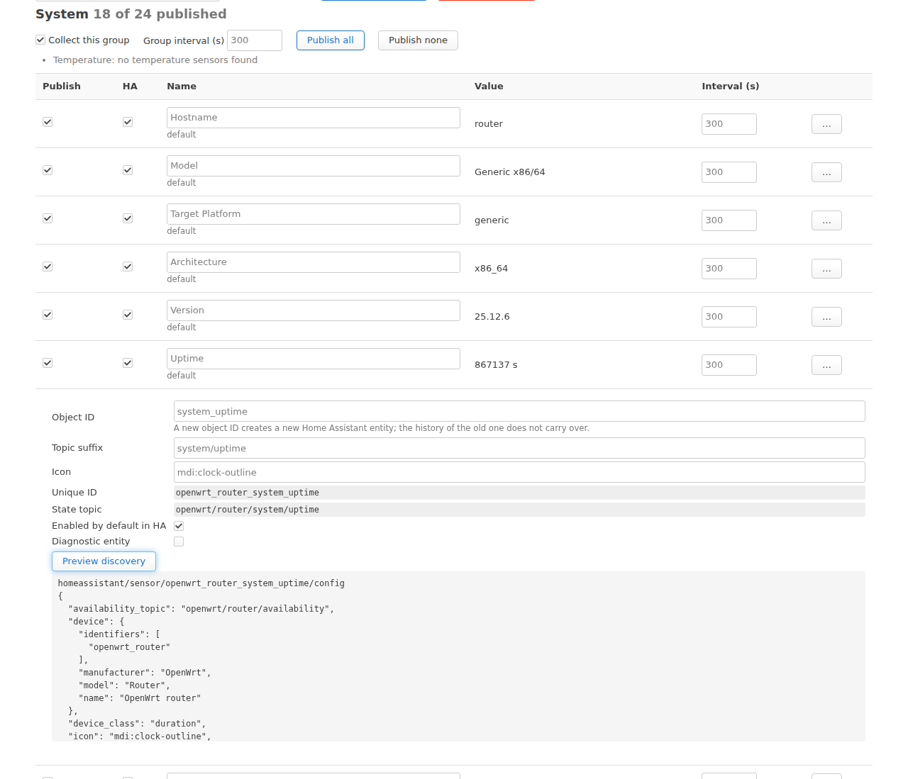
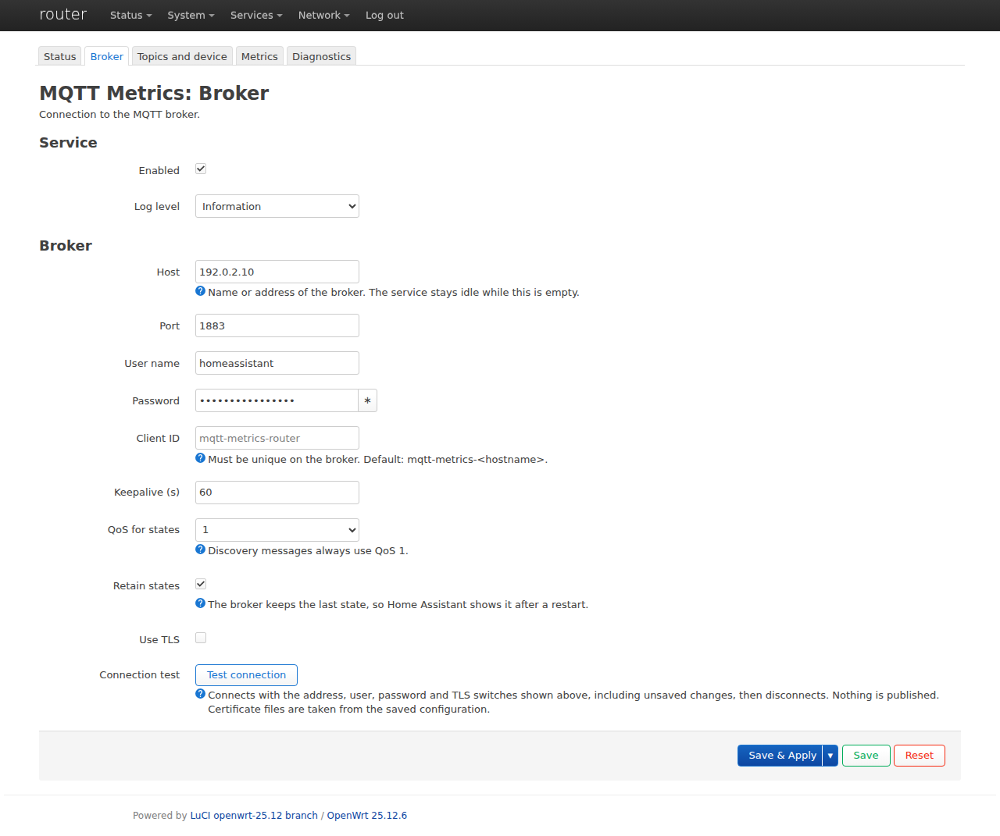
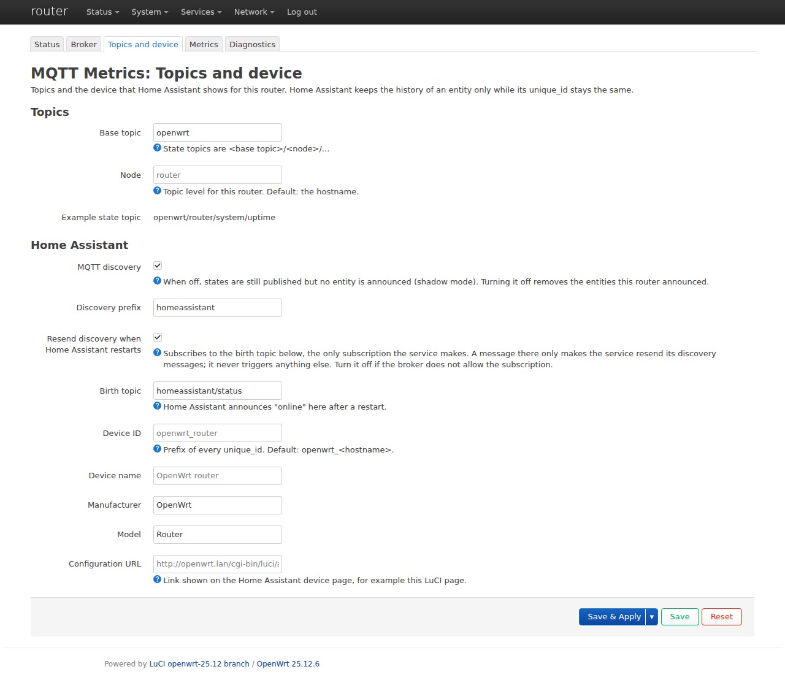
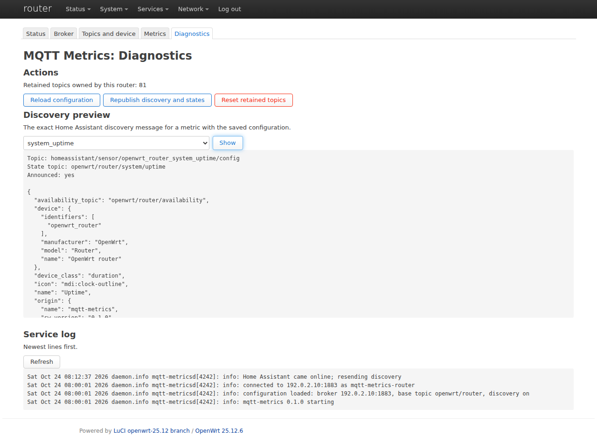
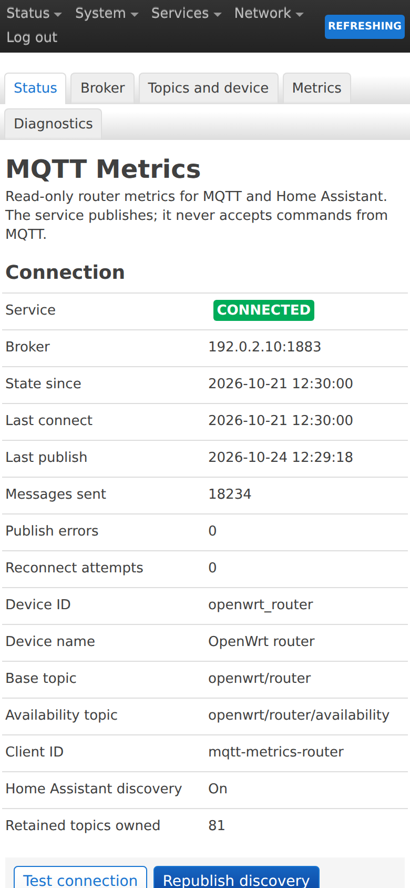

# mqtt-base-owrt-rs

OpenWrt packages that publish router state to an MQTT broker with Home
Assistant discovery:

- **`mqtt-metrics`**: a Rust daemon (`/usr/sbin/mqtt-metricsd`) with one
  persistent MQTT connection, Last Will availability, TLS and change-only
  publishing;
- **`luci-app-mqtt-metrics`**: the LuCI application under
  **Services → MQTT Metrics** (Status, Broker, Topics and device, Metrics,
  Diagnostics).

The integration is read-only. The router publishes; it never acts on
messages received over MQTT. The only subscription is the Home Assistant
birth topic, which makes the daemon resend discovery after Home Assistant
restarts.



## What is published

A fresh install publishes the default set: hostname, model, target platform,
architecture, firmware version and uptime, plus status, device, addresses
and gateways of every `wan*`/`wwan*` interface. The ids and topics of this
set do not change between versions, so Home Assistant keeps the history.
Everything else is opt-in on the Metrics page:

| Group | Metrics |
| --- | --- |
| System | firmware revision, kernel, boot time, load, CPU usage (total and per core), memory, root and tmp usage, swap, conntrack, temperatures |
| Network interfaces | any interface: status, device, IPv4, global IPv6, gateways, protocol, uptime, DNS servers, delegated prefix |
| Traffic | per device: byte counters, rates, errors, drops, link speed, carrier |
| Multi-WAN | mwan3 status, score, online time, per-target latency and loss |
| HA cluster | role, cluster state, peer and service health, VRRP states, sync age |
| DHCP | active IPv4 and IPv6 leases |
| WireGuard | peers per interface; per peer handshake age, connected, traffic |
| Wi-Fi | clients, channel and TX power per radio |
| Services | running state of the procd services you select |
| Packages | number of upgradable packages (from the local package index) |

Values a router cannot provide are shown in LuCI with the reason and are
never published as placeholders. The full reference, including topics and
entity ids, is in [docs/TOPICS.md](docs/TOPICS.md).

## Screenshots

| | |
| --- | --- |
|  |  |
| **Metrics**: choose what is published and what Home Assistant shows | **Metric details**: ids, topic, icon and the exact discovery message |
|  |  |
| **Broker**: address, credentials, TLS and a connection test | **Topics and device**: topic layout and the Home Assistant device |
|  |  |
| **Diagnostics**: actions, discovery preview and the service log | **Status** on a phone |

The pictures are taken on the real LuCI code with generic data
(`tools/docs-screenshots.browser.js`); addresses are from the documentation
ranges.

## Install

Requires OpenWrt 25.12 or later (apk). Download two files from the
[latest release](https://github.com/woffko/mqtt-base-owrt-rs/releases/latest):

- `mqtt-metrics_<version>_<arch>.apk` for the package architecture of your
  router, which `cat /etc/apk/arch` prints;
- `luci-app-mqtt-metrics_<version>_all.apk`, the same for every router.

Copy them to the router (for example with `scp -O`) and install:

```sh
apk add --allow-untrusted ./mqtt-metrics_*.apk ./luci-app-mqtt-metrics_*.apk
```

`--allow-untrusted` is needed because the packages are not signed with the
OpenWrt release key; check them against `SHA256SUMS` in the release.

Then open **Services → MQTT Metrics → Broker**, enter the broker and save.
The service stays idle until a broker host is set. The
[user guide](docs/USER_GUIDE.md) describes every page. An upgrade is the same
`apk add` with the new files; the configuration is kept.

Package architectures in the release and examples of hardware that uses
them:

| Architecture | OpenWrt targets | Examples |
| --- | --- | --- |
| `x86_64` | x86/64 | PCs, mini PCs, virtual machines |
| `i386_pentium4` | x86/generic | 32-bit PCs |
| `aarch64_cortex-a53` | mediatek/filogic, mediatek/mt7622, qualcommax, bcm27xx/bcm2710 | GL.iNet GL-MT3000 and GL-MT6000, Banana Pi BPI-R3 and BPI-R4, Qualcomm IPQ807x and IPQ60xx routers, Raspberry Pi 3 |
| `aarch64_cortex-a72` | bcm27xx/bcm2711, mvebu/cortexa72 | Raspberry Pi 4 and CM4, Marvell Armada 8040 boards |
| `aarch64_cortex-a76` | bcm27xx/bcm2712 | Raspberry Pi 5 |
| `aarch64_generic` | rockchip/armv8, layerscape/armv8_64b, armsr/armv8 | FriendlyELEC NanoPi R4S, R5S and R6S, NXP Layerscape boards |
| `arm_cortex-a7_neon-vfpv4` | ipq40xx, bcm27xx/bcm2709, sunxi/cortexa7 | Qualcomm IPQ40xx routers and access points, Raspberry Pi 2 |
| `arm_cortex-a7` | mediatek/mt7629 | MediaTek MT7629 routers |
| `arm_cortex-a9` | bcm53xx | Broadcom Northstar routers such as Netgear R7000 |
| `arm_cortex-a9_vfpv3-d16` | mvebu/cortexa9 | Linksys WRT1900AC, WRT3200ACM and WRT32X, Turris Omnia |
| `arm_cortex-a15_neon-vfpv4` | ipq806x, armsr/armv7 | Netgear R7800, TP-Link Archer C2600 |
| `mips_24kc` | ath79 | TP-Link Archer C7 and other Atheros/QCA routers |
| `mipsel_24kc` | ramips/mt7621, ramips/mt76x8 | Ubiquiti EdgeRouter X, Xiaomi Mi Router 4A Gigabit and other MT7621 and MT76x8 routers |

## Build

The repository is an OpenWrt package feed:

```text
package/mqtt-metrics/             daemon (Rust crate in src/)
package/luci-app-mqtt-metrics/    LuCI application
```

One SDK whose `rust/host` is built:

```sh
tools/sdk-build.sh /path/to/openwrt-sdk    # packages land in dist/
```

All release architectures with the official SDKs (downloaded and checked
against the published checksums; every SDK builds its Rust toolchain once,
which takes a while):

```sh
tools/release-build.sh /path/to/work-dir   # packages land in work-dir/out/<arch>/
```

Or add the feed from `feeds.conf.example` to an OpenWrt tree and run
`make package/mqtt-metrics/compile package/luci-app-mqtt-metrics/compile`.

Development checks (formatting, clippy, Rust and LuCI tests):

```sh
tools/check.sh
E2E=1 tools/check.sh    # also runs the daemon against a fake broker (about 90 s)
```

`tools/luci-real.browser.js` (part of the checks where Playwright and an SDK
are available) runs the LuCI pages on the real LuCI client code, and
`tools/e2e-smoke.sh` runs the real daemon against a fake broker and fake
`uci`/`ubus` commands. Run the second one before a deployment.

## Documentation

- [User guide](docs/USER_GUIDE.md)
- [Topics and entities](docs/TOPICS.md)
- [Release notes](docs/RELEASE_NOTES.md)
- [Design decisions](docs/decisions/); the original [work plan](docs/plan/PLAN.md)
  and the [evidence](docs/evidence/) of its phases are kept as history

## Licence

The daemon (`package/mqtt-metrics`) is GPL-2.0-or-later, the LuCI
application (`package/luci-app-mqtt-metrics`) is Apache-2.0. Licence texts
are in [LICENSES/](LICENSES/).
